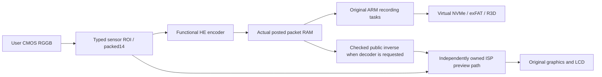

# shared221: functional recording, shared source and remaining work

This revision reuses one EXPEED7 board and one C ABI codec bridge in the Z9
and ZR repositories. **Recording evidence below belongs to ZR C1.11.** It
does not qualify Z9 movies, ZR C1.10, original Nikon algorithms or a physical
camera. Public-package native regression is recorded separately before release.

## Complete local original-firmware results

The original ARM application received real emulated HALF/FULL shutter contacts,
configured the modeled engines, wrote the files and stopped recording. No
instruction/PC patch, OS success value or fabricated START/STOP callback is
used. Boot still depends on explicit synthetic peripherals and supplied local
resources; this is not recovered Boot ROM or natural power-on.

| Format | First clip | Second clip | Independent checks |
| --- | --- | --- | --- |
| 4K HEVC Main10,30000/1001fps |909frames,30.330300s|909frames,30.330300s|All1818frames decoded as yuv420p10le; actual source leases and STOP ownership checked|
| 6K R3D NE,60000/1001fps |1803frames,30.080050s|1806frames,30.130100s|All3609actual RAW packets read and verified; independent public inverse, full AVC proxy decode and installed RED first/middle/last content checks|

Both formats completed two same-session START/STOP pairs followed by two
actual visible menus and fresh live-view returns. Main10 returns added9/11
RAW frames and36/38LCD frames; R3D returns added8/10RAW and41/45LCD frames.
Each whole native workflow used the same local reference binary:
`710db659ad23894935396b624f1eb3d0e41b07f76692b6e73a37c0af7570ffd7`.

R3D coded pictures are6060x3410; RED reports the visible6048x3402 crop.
The requested CMOS image is static. All3609picture codestreams therefore
have the same bytes. One full20,664,600-sample image was independently
decoded, and every repeat was compared by **complete byte identity**, not
hash equality alone. This covers74,578,541,400 sample positions without
pretending that3609different scenes or arithmetic decodes were tested.
RED rendered six original native-container frames with minimum green-rank
correlation0.957426 against the independent Bayer result. Export API success
alone is rejected: an offline-media error screen can also return true.

The dated public source/validation receipt distinguishes this local reference
from the independently built portable package. Their22compiled board/header
file bodies match after LF line-ending normalization; two add only an explicit GPL license prefix. The C++ codec archives also match byte-for-byte;
dated licensing comments do not change their machine code.

## Portable source-package recording qualification

Both current portable ZR profiles completed two recordings and two fresh menu returns. Their actual native files passed the same complete independent checks as the local reference. See [machine-readable qualification](recording-qualification221.json) for exact frame counts, result and audit fingerprints, original contact counts, source ownership and recovery deltas. R3D includes six actual RED-rendered first/middle/last content checks; all RAW packets and AVC proxy frames were checked. Main10 includes every decoded frame.

Both public repository entrypoints build the same qualified executable `efb038591fc58f3d5a8a85931b7ebbffb9a5fae9132b40fda652e94a771c5a3b`. The shared codec archive is byte-identical to the local reference. **ZR qualification does not qualify Z9 recording or the current Z9 photo port.** The earlier Z9 photo evidence retains its historical revision scope.

## Original code versus functional arithmetic

The camera's ARM menu, control, metadata, mux and filesystem instructions are
original user-supplied firmware. The current arithmetic backends are:

| Component | Current implementation | Qualification limit |
| --- | --- | --- |
| Sensor/ISP |Static user RGGB/u16, even-phase ROI, functional Bayer/YUV processing|Not a measured CMOS protocol, calibrated AE/AF/PDAF or Nikon ISP|
| RAW video |Authored HE forward transform/rate control and pinned public LibRaw inverse|Valid interoperable functional coding; not original Nikon encoder execution|
| HEVC/AVC |Public x265/x264 with actual submitted sources|Main10 syntax verified; current functional source has8bit-effective precision|
| JPEG |Host libjpeg with submitted quantizers|Not original Nikon JPEG arithmetic|
| DSP |Functional boot/message/session/motion/correction interfaces|No original CEVA instruction execution or original DSP result acceptance|

The RAW forward/inverse is deliberately lossy. The complete native-input
6K test has maximum error30 and mean error3.76067391 on a16383 range.
RED dark/color clipping is **not calibrated**. A syntactically10/14bit file
does not prove original sensor precision, original compression or correct color.
XM6 materials exist locally, their firmware-version equivalence is unverified;
detailed NeuPro documents are missing and local neural reproduction is
**inconclusive**. No original inference claim is made.

## Actual data paths



During native R3D recording the original application uses the parallel
uncompressed preview route. Do not claim that every live-view frame was
redecoded from the saved RAW picture. The diagnostic decoder route separately
checks actual packet-RAM readback, every Bayer/output pixel and IRQ ownership.
Native R3D data is not substituted into a private reference container.

The immutable opt-in `video-raw-he-codec-model` defaults off. The R3D profile
enables it. Its default header is authored typed syntax; it needs no SDK,
reference codestream or camera picture. Legacy WLVR/zlib remains a separate
simulator transport for other experimental paths and is never called R3D.

Persistent inverse integration fixes predecessor lifetime, incomplete-frame
success, precinct-prefix bounds, entropy underflow, prediction indices and
signed shifts. The public global inverse state is serialized. Final address,
undefined-behavior and leak checks include32repeated small/tail images,
8280x5520bounded-rate stress and the complete real6K input. Stress is not a
claim of calibrated8K quality or native Z9 video.

## Storage and progress lessons

The optional private-card backend losslessly deduplicates4KiB pages in SQLite;
it does not synthesize camera files.500overlapping writes, complete byte
comparisons and remount persistence passed. Standard sparse files remain the
portable default. Optional FUSE users must retain the generated initial card,
database and saved service receipt together, then remount before opening the
logical card symlink. Absolute Linux symlinks may not resolve through Windows
UNC; use the explicitly authenticated resolved FUSE backing path.

`video-recording-live.json` reports current encoder pictures every2wallseconds
through the owner's existing read-only QMP connection. Boundary snapshots are
historical. Encoded data can remain in the codec's167MB ring until STOP: a
quiet card mtime or the first snapshot's0pictures does not prove a stall.
An interrupted Main10 test was mistakenly stopped for that reason; it is
retained as interrupted evidence, not reported as a device regression.

The reusable bounded ISO BMFF index derives sample ranges from metadata.
It matched4443independent FFprobe packet entries, including >4GB offsets;
the3609large-file entries take about0.2s on the research host. Full payload
and pixel verification still reads every actual packet. This avoids reading
an extra28GB merely to obtain an index.

## Remaining requirements

Original ISA/ISP/DSP/H265/RAW/JPEG arithmetic, calibrated color, complete
held-burst/post-burst recovery, Z9 VIDEO, ZR1.10recording, physical SD/CFexpress
identity, physical sensor timing and general indefinite stability remain open.
Historical shared146 two-photo Z9/ZR evidence retains its original build scope.
Public firmware-free tests and a successful build are not native qualification.
Keep the original failure receipts and distinguish later reconciled audits
from the original pre-audit exit status.

The package is source-only. Users supply firmware and compatible resources;
private firmware/code, calibration, fonts/icons, SDKs, input pictures, RAW/cards,
recordings, screenshots and raw traces remain outside publication. See NOTICE
and the retained LGPL2.1/CDDL files and modification receipts for the public
LibRaw inverse. The integration selects LGPL version2.1.

## Reusable exact-file and RAW inspection commands

After the complete native runner exits, inspect its generated card without
repairing or modifying it:

```sh
python tools/recording_files.py --output /absolute/path/to/run-output
mkdir /absolute/path/to/empty-movie-view
python tools/recording_files.py --output /absolute/path/to/run-output \
    --mount /absolute/path/to/empty-movie-view
```

The second command stays in the foreground and requires libfuse2/fusepy.
Read the original MOV/R3D files directly from that directory using an independent
decoder. Close readers and run `fusermount -u /absolute/path/to/empty-movie-view`
to end the view. It replaces zero bytes and makes no alternative container.
The tool's clean filesystem/packet index is **not full codec acceptance**.

For an explicit copy, use the exact listed card-relative name and a fresh
local output outside tracked source:

```sh
python tools/recording_files.py --output /absolute/path/to/run-output \
    --extract-file DCIM/100NIKON/DSC_0001.MOV \
    --destination /absolute/path/to/private/DSC_0001.MOV
ffprobe -v error -show_streams -show_format /absolute/path/to/private/DSC_0001.MOV
ffmpeg -v error -xerror -threads 1 -i /absolute/path/to/private/DSC_0001.MOV \
    -map 0:v:0 -an -pix_fmt yuv420p10le -f framehash -hash sha256 \
    /absolute/path/to/private/DSC_0001.framehash
```

Count every frame and check timestamps, duration, actual10bit pixel format and
all decoder errors. For R3D the metadata inspector saves actual sample offsets
in `recording-files.json`; each current native RAW sample contains a1024-byte
wrapper followed by the HE picture. Extract the actual picture, not a reference.
The separately compiled public inverse CLI can be built without a camera SDK:

```sh
c++ -std=c++17 -O2 -I qemu/nikon-he-public tools/decode_he.cpp \
    qemu/nikon-he-public/*.cpp -o /absolute/path/to/private/decode-he
/absolute/path/to/private/decode-he /absolute/path/to/private/picture.jxs \
    /absolute/path/to/private/picture.bayer
```

The CLI outputs the complete u16 Bayer image and reports actual parsed geometry
and decode completion. Its implementation is the same pinned public inverse
used by the modeled decoder; it is separate from the authored forward encoder,
not a second independent inverse implementation. Independent RED verification
in the qualification adds that further interoperability check. Neither the CLI
nor a decoder Boolean substitutes for complete source/pixel/file binding.
